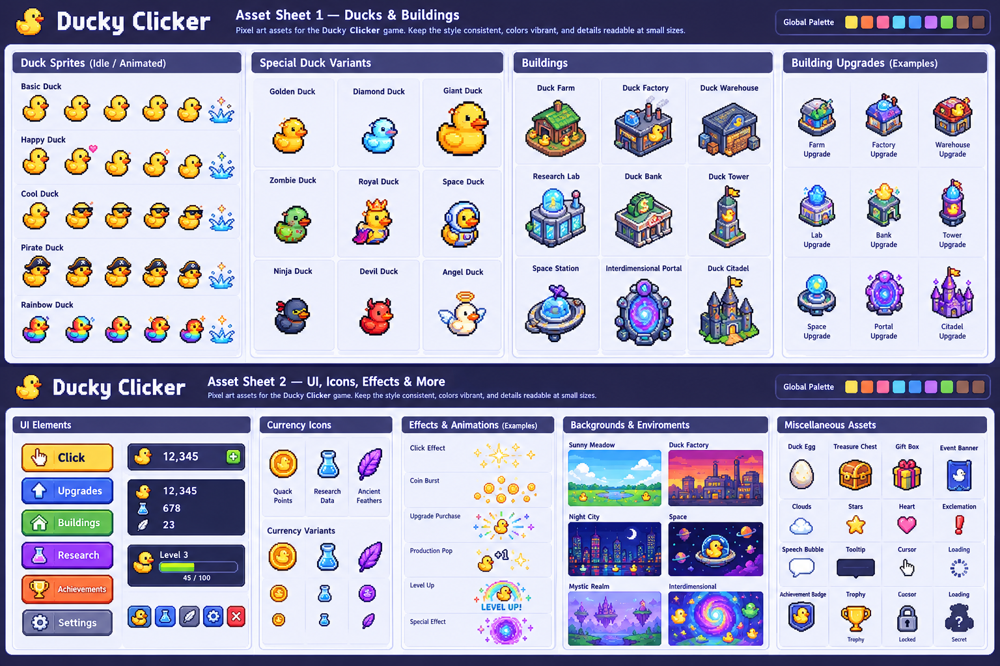

# Ducky Clicker — Art Direction

**Project:** Ducky Clicker  
**Status:** Initial visual direction  
**Last updated:** 2026-10-21  
**Related source of truth:** [SOURCE_OF_TRUTH.md](SOURCE_OF_TRUTH.md)

This document defines the visual and motion language for the interface, sprites, effects, environments, and future content.

## 1. Creative direction

**Core phrase:** A cozy, colorful pixel-art duck game that becomes increasingly unhinged.

The game should initially feel friendly, tactile, and charming. As Abby builds her empire, the world can become busier, stranger, more technological, and more cosmic while remaining part of the same playful universe.

Visual comedy should come from expressive sprites, unexpected props, funny silhouettes, readable visual storytelling, and well-timed effects—not from making every screen noisy.

## 2. Style pillars

### Pixel art first
- Use deliberately authored pixel-art sprites and environments, not blurry raster art with a pixel filter.
- Preserve crisp pixel edges. Avoid unintended blur, smoothing, and inconsistent scaling.
- Use a consistent pixel grid and coherent sprite scale within each asset family.
- Use nearest-neighbor scaling for pixel art when scaling is necessary.
- Keep sprites readable at their intended display size.

### Cute and expressive
- Rubber ducks need instantly recognizable silhouettes: rounded body, bill, and clear head/body separation.
- Give characters personality through small, legible variations in eyes, eyebrows, posture, and accessories.
- Prefer charming, goofy expressions over highly detailed faces.
- Distinguish character roles with silhouettes and accessories before relying on tiny details.

### Incrementally unhinged
- **Early game:** sunny, simple, domestic, welcoming.
- **Mid game:** busy factories, odd machinery, corporate signage, suspicious experiments.
- **Late game:** impossible geometry, stars, alternate timelines, strange relics, reality glitches.
- Escalate through the world and content; do not abruptly replace the core rendering style.

### Functional and readable
- UI text and icons must remain legible on small phone screens.
- Gameplay information takes priority over decoration.
- Keep the main clickable duck and essential buttons visually clear.
- Limit simultaneous effects so clicks and purchases remain easy to read.

## 3. Palette guidance

Use a compact, reusable palette with semantic roles. Exact hex values are provisional until the first in-game screen is reviewed.

| Role | Direction |
|---|---|
| Primary duck | Warm sunny yellow with deeper golden shadow |
| Bill / feet / highlights | Warm orange, coral, or amber accents |
| Background | Soft cream, pale sky blue, or muted pond blue |
| Early-game nature | Leaf green, pond teal, warm wood brown |
| UI panels | Cream, warm gray, muted blue, or dark navy for contrast |
| Positive feedback | Fresh green, used sparingly |
| Rare rewards | Bright gold with restrained sparkle |
| Research / technology | Cyan, violet, and cool blue accents |
| Mystery / danger | Deep indigo, plum, or muted red balanced against the cute base palette |

Palette rules:
- Use color consistently by function.
- Maintain sufficient contrast between text, controls, and backgrounds.
- Do not communicate affordability, rarity, or warnings through color alone; use labels, icons, borders, or shapes too.
- Avoid introducing a new accent color for every feature.
- Keep bright effects brief and localized.

## 4. Pixel scale and sprite construction

Until the engine and target resolution are confirmed, these are guidelines rather than fixed technical requirements.

- Build around a consistent low-resolution pixel grid.
- Use a small, deliberate color cluster per sprite; reserve extra shades for important focal assets.
- Prefer clean silhouettes and purposeful clusters over isolated noisy pixels.
- Use consistent light direction within a scene or asset family.
- Keep outlines consistent. Dark brown or deep navy may feel softer than pure black for the cute base game.
- Do not mix detailed high-resolution art with tiny low-detail sprites in the same layer without an intentional reason.
- UI icons should share the visual weight and pixel scale of related sprites.
- Important sprites must remain recognizable at a glance.

## 5. Main duck: central focal point

The main duck is the primary interaction target and should receive the most visual attention.

Required visual states:
- **Idle:** subtle breathing, blinking, or a small buoyant bob.
- **Click:** brief squash or downward bounce, then quick recovery.
- **Reward:** small readable pop or floating number.
- **Purchase/unlock:** distinct feedback that does not obscure the duck.
- **Special event:** clearly different sparkle, outline, or short animation.
- **Unavailable interaction, if applicable:** visually clear without making the duck look broken.

Motion should feel springy, light, and satisfying. Avoid long animations that delay repeated clicks. Keep the duck easy to tap on touchscreens.

## 6. Animation and effects

- Favor short, snappy animations with clear anticipation and recovery.
- Use floating numbers, brief sparkles, tiny feathers, bubbles, or pixel bursts for positive actions.
- Keep ordinary click effects modest; reserve large bursts for milestones and rare events.
- Use sprite animation or small positional changes to create life without making the entire screen move.
- Avoid excessive screen shake, persistent flashing, or overlapping effects that hide information.
- Keep interactions responsive while animations play.
- Support reduced motion where feasible.
- Ensure effects do not capture touch/pointer input or block unrelated controls.

### Effect hierarchy
1. **Routine click:** tiny bounce and compact floating reward.
2. **Purchase:** short confirmation pulse and a small change on the purchased item.
3. **Milestone:** larger but brief burst, celebratory sound, and clear announcement.
4. **Rare event:** distinct accent color and recognizable sprite treatment.
5. **Major lore reveal / prestige:** memorable sequence with a skip or reduced-motion path where practical.

## 7. UI and layout

The interface should feel like a polished retro game, not a generic dashboard covered in modern cards.

### Main screen
- Currency and production summaries near the top, with clear labels and compact number formatting.
- The main duck occupies the visual center or primary interaction area.
- Producers and upgrades appear in a scannable list or grid suitable for mobile.
- Navigation leads to Shop, Factory, Research, Duckipedia, Collection, and Achievements as those features become available.
- Special-event messages should be dismissible and must not cover core controls for long periods.

### Upgrade entries
Make these elements easy to identify:
- Name and small pixel-art icon/sprite.
- Price and affordability.
- Effect or production rate.
- Owned count where relevant.
- Unlock requirement or explanation when locked.

Use typography, spacing, and panel contrast to establish hierarchy. Keep tap targets generous. A readable UI font can complement pixel-art sprites; long descriptions should not use tiny novelty lettering.

### Navigation and secondary screens
- Keep navigation consistent as systems are added.
- Reuse panel, heading, button, and selected-state patterns.
- Collections and the Duckipedia can feel like a sticker book, field guide, or catalog while preserving text readability.
- Research can use connected nodes if requirements and available choices remain clear.
- Prestige should feel significant without hiding the consequences of a reset.

## 8. Typography

- Use a legible pixel-inspired font for short headings, currency labels, and UI accents.
- Use a readable bitmap or standard UI font for long descriptions, dialogue, and lore.
- Avoid all-caps for every sentence; reserve it for labels, announcements, and comedic emphasis.
- Keep numeric displays stable where possible so changing values do not cause distracting layout shifts.
- Verify glyph support for punctuation and every character used in the writing.

## 9. Visual escalation by stage

### Early game — Cozy and simple
Bright, warm palette; clean background; one standout duck and a few clear UI panels; tiny bubbles, simple props, gentle motion.

### Mid game — Industrial absurdity
Conveyor belts, toy presses, duck workers, factory signage, and odd equipment. Add mechanical motion while preserving visual breathing room. Introduce suspicious details through corporate iconography and research props.

### Late game — Cosmic weirdness
Use deep-space colors and strange environmental patterns as accents rather than a total visual reset. Add dimensional portals, fractured timelines, impossible machinery, and ancient artifacts. Keep special ducks strongly silhouetted. Glitches must be brief and never compromise readability or input.

## 10. Asset naming and organization

Once the project structure is established, use predictable, lowercase, descriptive filenames. Adapt folders and extensions to the chosen engine, but keep conceptual groups consistent.

Suggested groups:
- **ducks/** — main duck, variants, characters, expressions.
- **producers/** — producer/building icons and sprites.
- **upgrades/** — upgrade icons.
- **ui/** — buttons, panels, navigation icons, currency icons.
- **effects/** — click bursts, bubbles, feathers, sparkles, reward effects.
- **environments/** — backgrounds, factory scenes, cosmic scenes.
- **portraits/** — character portraits and dialogue art.
- **lore/** — visual assets for entries, relics, and discoveries.
- **audio/** — click, purchase, unlock, ambient, and event sounds.

Prefer reusable sprite sheets or atlases when supported. Keep source files and export settings organized so assets can be revised without recreating them.

## 11. Asset acceptance checklist

Before accepting an asset, verify:
- It reads clearly at the intended size.
- Palette and outline treatment match related assets.
- Pixel edges remain crisp at runtime.
- Its silhouette is distinct from similar assets.
- Details support gameplay or character personality.
- It works against the intended background and has sufficient contrast.
- Animation loops cleanly and does not distract from input.
- Transparent/opaque background behavior is correct.
- Filename and location match project conventions.
- It introduces no accidental dependency on another project's assets.

## 12. Avoid

- Photorealistic rubber ducks mixed into the pixel-art world.
- Raster imagery passed off as finished pixel sprites without deliberate cleanup and review.
- Blurry scaling, anti-aliased pixel edges, inconsistent pixel grids, and mismatched outline weights.
- Overly detailed sprites that become muddy at display size.
- Constant screen shake, endless particle spam, and large effects for routine clicks.
- Tiny unreadable text or precision-only controls.
- Too many simultaneous accent colors or decorative borders.
- Horror imagery that breaks the cute-but-unhinged tone; strange and unsettling is fine, but the identity stays playful.
- Copying recognizable characters, sprites, branding, or assets from other games. Use incremental games as mechanical inspiration, not as an art template.

## 13. Decision log

- **2026-10-21:** Pixel art selected as the visual style.
- **2026-10-21:** Tone selected as cute but increasingly unhinged.
- **2026-10-21:** Mobile-friendly readability is a priority.
- **Pending:** Confirm engine, native resolution, target pixel scale, font, and exact palette after the first screen is implemented.

## 14. Relationship to the source of truth

[SOURCE_OF_TRUTH.md](SOURCE_OF_TRUTH.md) defines the game's purpose, systems, boundaries, and implementation priorities. This document governs visual execution. If a visual choice harms readability, accessibility, or core interaction, preserve gameplay clarity and adapt the art treatment.

## 15. Duckling Helper character treatment

Duckling Helpers should read as baby ducks at a glance, not as smaller copies of the adult rubber duck. Use an oversized round head, a compact little body, a short forward-facing orange bill, a single clear eye, tiny feet, and a small feather tuft. Keep the warm yellow highlights, golden shadows, and dark brown pixel outline consistent with the reference sheet. The same baby-duck design should be used for the producer-card icon and the in-scene walking helpers so the UI and world feel connected.

In the first playable implementation, each purchased Duckling Helper appears in the pond scene and waddles within the grassy play area. Movement is gentle and low-key, remains behind the main clickable duck, and must not block taps or controls. The current sprite is inline SVG pixel-style art; compare it against the reference sheet during the next visual review.

## 15. Generated asset-sheet references

The generated Ducky Clicker concept sheet establishes a shared visual direction for future art production. Treat it as a **style and content reference**, not as a finished sprite atlas ready to slice directly into the game.

### Asset Sheet 1 — Ducks & Buildings
Reference categories shown:
- Main rubber duck poses and expressions, including idle-like variations and happy/cool/pirate/rainbow treatments.
- Special duck concepts: golden, diamond, giant, zombie, royal, space, ninja, devil, and angel ducks.
- Producer/building concepts: duck farm, factory, warehouse, research lab, duck bank, duck tower, space station, interdimensional portal, and duck citadel.
- Matching building-upgrade concepts.

### Asset Sheet 2 — UI, Icons, Effects & Environments
Reference categories shown:
- Main navigation and action buttons, compact currency/HUD displays, and level/progress elements.
- Currency concepts for Quack Points, Research Data, and Ancient Feathers.
- Click, coin, purchase, production, level-up, and special-event effects.
- Environment concepts spanning sunny meadow, factory, night city, space, mystic realm, and interdimensional settings.
- Supporting items and symbols such as eggs, treasure chests, gifts, event banners, clouds, stars, hearts, speech bubbles, tooltips, cursors, badges, trophies, locks, and secrets.

### Shared style rules from the sheets
- Keep the same crisp, outlined pixel-art treatment across ducks, buildings, UI icons, effects, and backgrounds.
- Use a warm yellow/orange duck base and a consistent dark outline; use gold for rewards, cyan/blue for research and technology, green for nature/positive feedback, and violet/indigo for cosmic or mysterious content.
- Preserve recognizable silhouettes and readable clusters at actual mobile display sizes. Avoid relying on tiny details or color alone to distinguish an asset.
- Keep UI buttons chunky, high-contrast, and easy to tap on iPhone. Maintain clear spacing between interactive targets.
- Escalate from cozy nature through industrial absurdity to cosmic weirdness without changing the core pixel-art rendering style.
- Treat the names and systems shown in the concept sheet as visual proposals, not automatic canon. Check SOURCE_OF_TRUTH.md before implementing a named gameplay system or currency.

### Production and implementation cautions
- The sheet is a mood/style guide. Do not display the entire sheet as a substitute for individual in-game assets.
- Before shipping, create or extract individual sprites with transparent backgrounds where appropriate, consistent pixel dimensions, clean edges, and sensible filenames under the project’s asset folders.
- Do not use the full sheet as a single clickable image or pretend its example UI is functional.
- Review generated lettering and small details manually; generated text may be malformed. Recreate actual game text with the chosen UI font.
- Confirm licensing/provenance and project asset-storage requirements before incorporating exported assets into a release.
- Where a concept conflicts with gameplay clarity, mobile usability, accessibility, or the Source of Truth, those requirements take precedence.

**Reference asset status:** The generated pixel-art concept sheet is stored at [`assets/reference/ducky-clicker-asset-sheets.png`](../assets/reference/ducky-clicker-asset-sheets.png) as the canonical visual reference for future art and implementation.

Keep this path stable so future implementation work can reliably find the reference.

## 16. Main screen layout update

The main play screen uses a two-column desktop/tablet layout: the duck tap scene sits in the upper-left play column, with an upgrades panel directly beneath it. The producer/shop panel occupies the right column as a vertically scrollable list so future producers can be added without making the play area excessively tall. On narrow screens, the columns stack into a single readable touch-friendly flow. The upgrades panel has a clear empty state until real upgrade definitions and unlock logic are implemented; it must not display fake purchasable controls.
